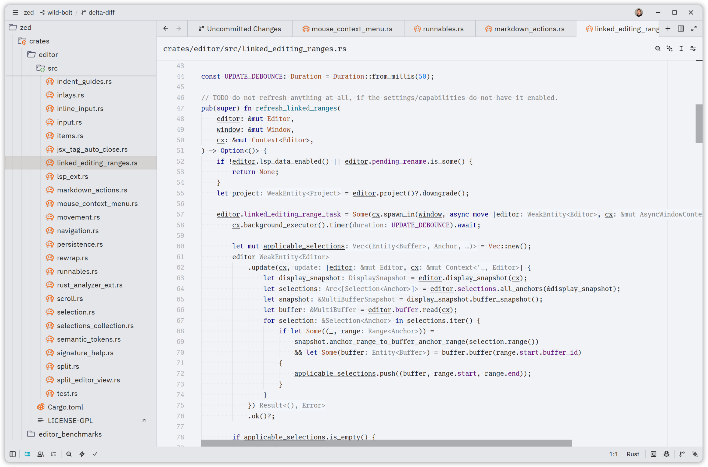

# Cyan Light Theme for Zed

A port of the [Cyan Light Theme](https://plugins.jetbrains.com/plugin/12102-cyan-light-theme) from the JetBrains Marketplace to [Zed](https://zed.dev).

## Install

Search for "Cyan Light Theme 2" in Zed's extension marketplace (`zed: extensions`).

## Matching RustRover

Colors come from the JetBrains theme, its parent `Default` scheme and RustRover's Rust defaults.
Some Rust highlighting depends on rust-analyzer token modifiers, which a theme can't select.
To match RustRover, add these to `settings.json` (with `"semantic_tokens": "combined"` or `"full"`):

```jsonc
"global_lsp_settings": {
  "semantic_token_rules": [
    // Primitive types and `Self` as keywords
    { "token_type": "builtinType", "style": ["type.builtin"] },
    { "token_type": "selfTypeKeyword", "style": ["keyword"] },
    // Crate names, trait methods (italic), statics, macro `!`, `#[...]`, `?`
    { "token_type": "namespace", "token_modifiers": ["crateRoot"], "style": ["namespace.crate"] },
    { "token_type": "method", "token_modifiers": ["trait"], "style": ["function.method.trait"] },
    { "token_type": "static", "style": ["constant.static"] },
    { "token_type": "macroBang", "style": ["function.macro"] },
    { "token_type": "attributeBracket", "style": ["attribute"] },
    { "token_type": "operator", "token_modifiers": ["controlFlow"], "style": ["operator.try"] },
    // Underlined mutable bindings
    { "token_type": "variable", "token_modifiers": ["mutable"], "underline": "#2b2d30" },
    { "token_type": "parameter", "token_modifiers": ["mutable"], "underline": "#909090" },
    { "token_type": "selfKeyword", "token_modifiers": ["mutable"], "underline": "#909090" },
    // Unsafe operations background
    { "token_type": "function", "token_modifiers": ["unsafe"], "background_color": "#f8d4c9" },
    { "token_type": "method", "token_modifiers": ["unsafe"], "background_color": "#f8d4c9" },
    { "token_type": "operator", "token_modifiers": ["unsafe"], "background_color": "#f8d4c9" }
  ]
}
```

The underline and background colors are fixed values, so they stay when you switch themes.

## Preview



## Credits

Original IntelliJ theme by [Olga Berdnikova](https://plugins.jetbrains.com/plugin/12102-cyan-light-theme).

## License

[MIT](LICENSE)
